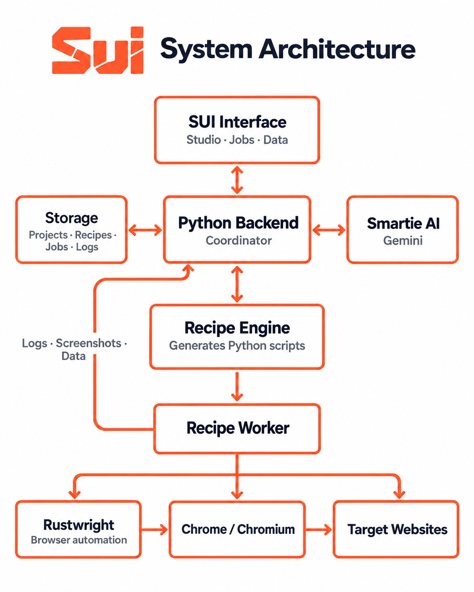

# Sui


Sui is a smart RPA studio. Build browser automations, run them, and inspect their logs and data.

## How it works



- React provides the studio interface.
- The Python backend manages the API, SQLite data, recipes, and job logs.
- Saved recipes are turned into Python scripts and run by the backend.
- Browser automation uses [Rustwright](https://github.com/Skyvern-AI/rustwright), a Python API backed by a native Rust engine that controls Chromium.

Sui itself is primarily React and Python; the Rust code comes from the Rustwright dependency.

## Requirements

- Python 3.13
- [`uv`](https://docs.astral.sh/uv/)
- Node.js and npm
- Chrome or another Chromium-based browser

The commands below use PowerShell. On macOS or Linux, use the equivalent commands for your shell.

## Quick start

Start Sui in two terminals, both opened in the project folder.

**Terminal 1 - backend:**

```powershell
uv sync
.\.venv\Scripts\activate
uv run .\main.py
```

**Terminal 2 - frontend:**

```powershell
cd frontend
npm install
npm run dev
```

Open the Vite URL shown in Terminal 2. It is usually:

http://localhost:5173

Run `uv sync` and `npm install` during initial setup or when dependencies change.

## Optional: enable Smartie

Smartie uses Google Gemini. If you want to use it, create a `.env` file in the project folder:

```dotenv
GOOGLE_GEMINI_KEY=your-gemini-api-key
```

Keep this key private. `.env` is ignored by Git.

## First steps

1. Open Studio and create a project.
2. Add a recipe, starting with **Navigate to website**.
3. Add and configure the activities you need, then save the project.
4. Run a step or the full recipe.
5. Open Jobs to view execution status and logs.
6. Open `/data` to view or create SQLite tables.

## Serve the built app from Python

Use this when you want one backend-served app instead of the Vite development server. After installing dependencies, run these commands from the project folder:

```powershell
cd frontend
npm run build
cd ..
uv run .\main.py
```

Open http://127.0.0.1:8000.

Run `npm run build` again whenever you change the frontend.

## Local data

Sui stores local runtime data in:

- `data/sui.db` - projects, recipes, jobs, logs, and tables
- `data/generated/` - generated Python for saved recipes
- `.venv/` - the local Python environment